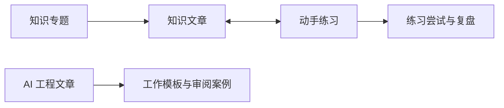

# 信息架构、路由与搜索

## 导航

全站只有一条顶栏：知序标识、知识地图、动手练习、AI 工程、搜索。不设侧栏、总览、设置页、面包屑或底部导航。打开站点进入知识地图。阅读页用正文里的返回链接回到专题。

手机顶栏分成三行：品牌、三个分区、搜索。触控目标至少 44 px。

## 页面与 URL

| 页 ID | 页面 | 路径 | 主要入口 |
| --- | --- | --- | --- |
| S02 | 知识地图 | `/`、`/knowledge` | 品牌、导航。`/` 重定向到 `/knowledge` |
| S03 | 专题目录 | `/knowledge/:domain` | 地图分组 |
| S04 | 知识阅读 | `/knowledge/:domain/:slug` | 目录、搜索、关联项 |
| S05 | 动手练习列表 | `/practice` | 导航、知识页 |
| S06 | 练习工作台 | `/practice/:slug` | 列表、薄弱项 |
| S07 | AI 工程 | `/ai` | 导航 |
| S08 | AI 文章/模板/案例 | `/ai/:slug` | AI 分类、搜索 |
| S12 | 设置与数据 | `/settings` | 已移出。旧地址按找不到内容处理。练习草稿仍在浏览器中自动保存 |
| S13 | 完整搜索结果 | `/search?q=…&type=…` | 搜索弹层「查看全部」 |
| S14 | 找不到内容 | 无匹配路径 | 链接失效 |

模板和案例使用 S08 的同一阅读壳，通过内容 kind 区分；不另造一套页面。复习计划（S09/S10）和我的积累（S11）已移出产品，旧地址按找不到内容处理。已有本地笔记与评分仍留在备份数据中，不在页面展示。

## 内容关系

关联使用不可变 ID，不依赖标题或路径。slug 可以调整，但旧 URL 必须通过重定向表继续定位。专题调整不改变用户记录归属。图用于说明关系，首版页面展示为分组列表和关联链接。

## 筛选与排序

- 知识：专题、深度、阅读状态、收藏；默认课程顺序。阅读状态为未读/在读/已读，不混入熟练度。
- 练习：主题、难度、完成证据、运行环境；默认推荐顺序，可切最近练过、未尝试。
- AI：基础概念/协作流程/审阅验证/工具协议/应用工程/近期变化；可筛待核验。
- 每组内部多选为 OR，组间为 AND。筛选结果实时更新计数；「清除筛选」恢复默认。
- 列表页每页 24 项；筛选或排序变更回第 1 页；浏览器返回恢复筛选与滚动位置。
- 查询参数白名单：q、domain、level、status、tag、sort、page、type；非法值回默认并替换 URL，不让页面崩溃。

## 搜索契约

首版客户端全文索引覆盖标题、别名、标签、摘要、正文小标题及正文；不索引折叠答案、参考实现、测试源码，避免搜索提前泄露解答。个人笔记仅在「我的笔记」类型显式启用后从本地索引搜索，不进入公共构建产物。

输入处理：去首尾空白、拉丁大小写归一、全半角归一；中文使用分词或二元切分索引，英文按词；标题的中文连续短语额外做子串匹配。别名由内容维护，例如 闭包/closure、任务循环/event loop、并发限制/promise pool、检索增强/RAG。

排序是可解释的分档：标题精确匹配 > 标题/别名短语匹配 > 标签和小标题 > 摘要 > 正文；同档按核心程度、课程顺序、稳定 ID。首版不做拼写自动纠正或远程语义检索。测试语料固定，换搜索库也应维持语义排序。

输入 150 ms 防抖；中文输入法组合期间不触发查询。空查询显示最近打开的 6 条内容和 6 个常用标签。弹层最多 8 项，底部展示完整结果入口；完整结果每页 24 项。搜索清空不清除学习历史。

结果展示：类型、标题、1—2 行命中摘要、专题、更新时间。高亮必须使用文本节点拆分，不把查询字符串拼进 HTML。无结果提供清除筛选、尝试别名的提示，不伪造推荐结果。

## 跳转与恢复

文章章节用持久 headingId 锚点。优先级：URL 指定锚点 > 同一文章保存的阅读位置 > 文章顶部。短暂显示「已回到上次阅读位置」，允许返回顶部。跳转后主标题获得程序焦点，不能打断输入控件中的输入。不存在的章节回文章顶部并提示，文章删除后展示归档信息和替代条目。
