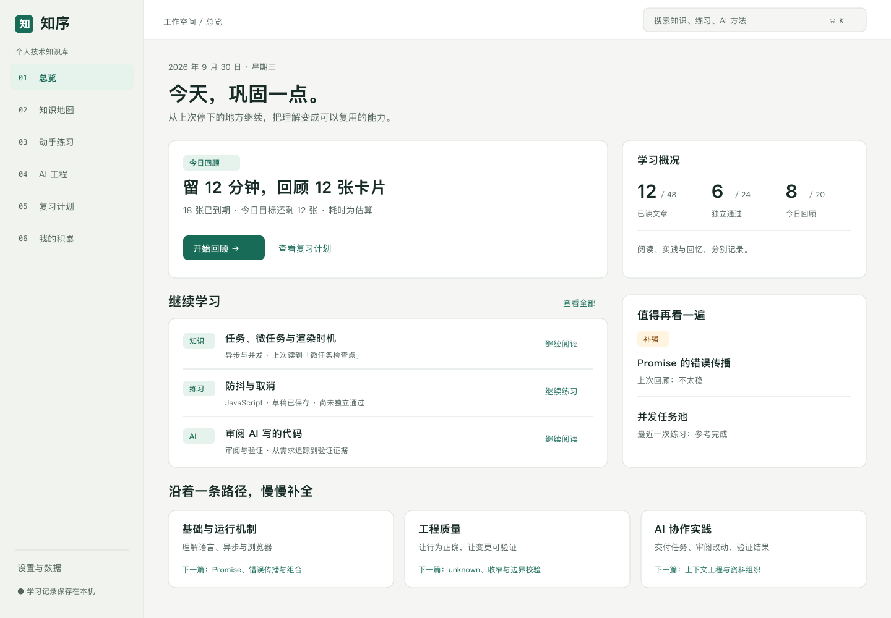
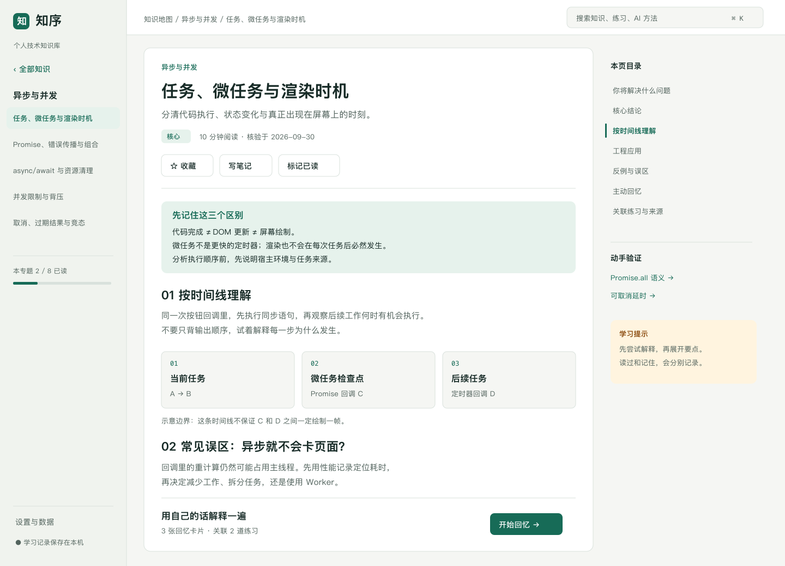
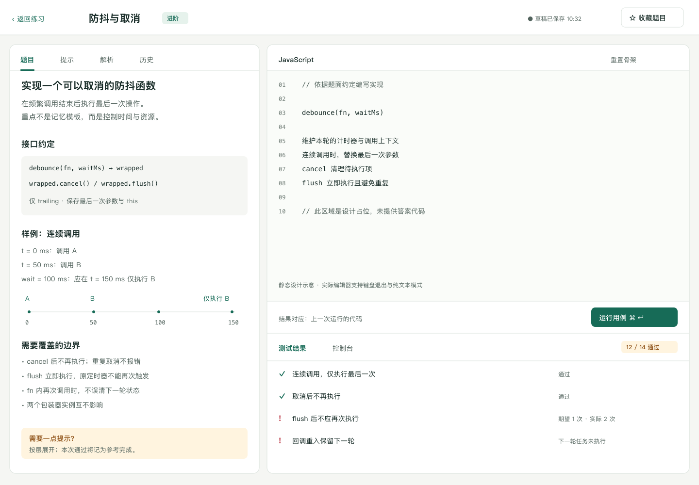
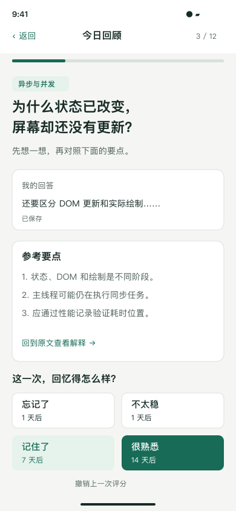

# 静态页面设计图

采用用户确认的浅色技术手册方向。SVG 为可缩放设计源，PNG 为已渲染预览；不是网站代码或可点击原型。系统字体随操作系统略有差异，实现时以 [视觉规范](../04-design-system.md) 和 [页面规格](../05-pages.md) 为准。

## 总览 · 1440 × 1000

优先级：今日回顾 → 继续学习 → 学习概况/补强 → 推荐路径。首屏无营销横幅。图下继续滚动展示“近期内容变化”，规则见 S01。

[SVG 源文件](01-overview.svg) · [PNG 预览](01-overview.png)

## 知识阅读 · 1440 × 1040

这张图是历史草图：右页内提纲、正文笔记区按 D14 已取消；当前采用阅读区单栏，见 05 的 S04 与 docs/verification 阅读截图。图中是文章结构的浓缩示意，不替代完整正文顺序。展开完整内容阶段的目录可有 8 篇；P0 首发只把每专题前 2 篇作为可读链接，其余遵循 S03 的后续计划展示规则。

[SVG 源文件](02-reading.svg) · [PNG 预览](02-reading.png)

## 练习工作台 · 1440 × 1000

左边合同和边界，右边编辑与结果。示例处于“草稿已保存、上次运行部分失败”，结果区只截取 4 行，其余用例在区内滚动。代码区域是布局说明，不是题目答案。底部提示为展开提示入口说明，实际交互见 S06。

[SVG 源文件](03-practice.svg) · [PNG 预览](03-practice.png)

## 手机复习 · 390 × 844

示例已展开答案、旧 stage=2，因此“记住了”为 7 天后，“很熟悉”为 14 天后。未展开状态应隐藏答案和四个评分按钮，改为“显示要点”，详见 S10。手机阅读和列表按 04 的断点规则改成单列。

[SVG 源文件](04-mobile-review.svg) · [PNG 预览](04-mobile-review.png)

## 复现要求

- 不将示例个人数字写死到网站。
- 图中不包含所有异常弹窗，必须实现 05 的异常矩阵。
- 主操作、正文宽度、三栏/双栏/单列转换是核心；不要用任意现成模板替换。
- 实际页面支持字号调整、键盘焦点、读屏和内容增高；不能用截图做页面。
- PNG 已检查文字与布局可辨认；静态图不能证明真实网页响应式、可访问性或保存行为正确。
